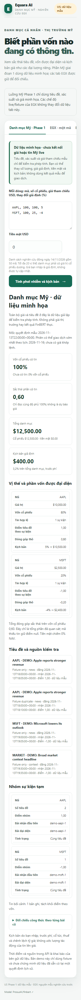

# Equara — danh mục Mỹ (Phase 1) và bản nghiên cứu EGX

## Danh mục Mỹ — Phase 1

Trang mặc định có tab **Danh mục Mỹ · Phase 1**. Tab này nhận số lượng cổ phiếu,
giá tham chiếu người dùng nhập, tiền mặt và thay đổi giá giả định; API tính vốn có
tin, sắc thái trên phần vốn có tin, từng đóng góp và kịch bản giá. Đối chiếu công
thức EGX cũ nằm trong phần mở rộng ở cuối kết quả.

Chế độ **fixture** dùng dữ liệu giả lập. Tiêu đề, xác suất và ngày tin trong
`fixtures/us_portfolio_phase1.json` được viết để kiểm tra phần mềm, không do
FinBERT chấm hoặc được lấy từ nhà cung cấp. Giá trong chế độ fixture cũng do
người dùng nhập như giả định. Chế độ **sổ cái cục bộ** đọc dữ liệu SEC, Alpaca
và giá SIP đã thu thập trên máy; mẻ đầu là hồi cứu. PiT nghiêm ngặt chỉ dùng
bản ghi Equara đã nhận trước mốc quyết định. Replay cho xem dữ liệu tải sau
mốc đó và luôn gắn cấp `EXPLORATORY_NON_PIT_DIAGNOSTIC_ONLY`. Không dùng tab
này để giao dịch.

## Interface preview

The default US portfolio view uses a clearly labeled synthetic fixture. The desktop and mobile captures below show the interface; sample prices and headlines are not live market data.



Danh sách 50 mã nghiên cứu được đóng ngày 15/11/2026 trong
`backend/universe/us_universe_v1.json`, với mã/sàn/CIK từ bảng ghép mã SEC.
SEC không bảo đảm bảng đầy đủ hoặc luôn chính xác; bảng đó không chứng nhận loại
cổ phiếu, thanh khoản hoặc vốn hóa. Danh sách này cần thẩm định độc lập trước
khi dùng cho nghiên cứu giao dịch. Lịch NYSE được đóng theo lịch chính thức
2026–2028; ngày đóng cửa đột xuất không thể được biết trước bởi file tĩnh.

API mới:

- `GET /api/v3/us/universe`: danh sách 50 mã và phạm vi nguồn.
- `GET /api/v3/us/fixture`: lô tin giả lập để kiểm tra.
- `POST /api/v3/us/portfolio/exposure`: tính trên input do caller cung cấp;
  trả `coverage`, `covered_portfolio_score`, `raw_equity_weighted_score`,
  kịch bản và phép tính cũ trên cùng lô.
- `POST /api/v3/us/snapshot`: snapshot từ ledger, có chế độ PiT/replay, kịch bản
  giá giả định, điểm FinBERT và nhật ký loại bản ghi.
- `GET /api/v3/us/audit-summary`: thống kê ledger hiện tại và các báo cáo
  Phase 3 đã tạo trong `artifacts/`.

Mọi timestamp và provenance tier ở POST là **khai báo của caller**, chưa phải
chứng cứ PiT được xác nhận độc lập. Endpoint chặn timestamp thiếu timezone hoặc
đến sau mốc quyết định, nhưng không thể chứng thực nhà cung cấp, quyền dữ liệu,
thời điểm tin thực sự đến thị trường hoặc lịch sử giá. Xem
`docs/US_PHASE1_STATUS.md` cho hợp đồng và giới hạn.

Nguồn tham khảo:
[SEC ticker/CIK/exchange](https://www.sec.gov/files/company_tickers_exchange.json),
[NYSE calendar](https://www.nyse.com/trade/hours-calendars).

Nguyên mẫu phân tích sắc thái tiêu đề tin tài chính tiếng Anh cho cổ phiếu trên sàn Ai Cập EGX. Dự án kế thừa FinBERT và mở rộng cách tổng hợp, truy nguyên điểm tin, đối chiếu với giá ngày.

## Chức năng

| Chức năng | Dữ liệu và kết quả |
|---|---|
| Một cổ phiếu | Thu thập tiêu đề, chấm xác suất tích cực/trung tính/tiêu cực |
| Danh mục gốc | Tối đa 2 tin riêng mỗi mã và 4 tin vĩ mô, trung bình điểm từng tiêu đề |
| Danh mục điều chỉnh theo vốn | Dùng chính lô tin gốc, điều chỉnh trọng số tin riêng theo vốn, hiển thị đóng góp từng tin |
| Tin + Giá | Thu tin riêng, gom gần trùng, giảm theo tuổi, đối chiếu giá ngày và phát 5 nhãn theo quy tắc thử nghiệm |

## Khởi chạy

Cần Python 3.12. Node.js hỗ trợ các kiểm thử phép tính JavaScript. Chạy trong thư mục repository.

```powershell
py -3.12 -m venv .venv
.\.venv\Scripts\python.exe -m pip install -r requirements.txt
$env:DEMO_MODE='live'
$env:INFERENCE_PROVIDER='transformers-local'
.\.venv\Scripts\python.exe -m uvicorn backend.app:app --host 127.0.0.1 --port 8124
```

Mở http://127.0.0.1:8124 và tài liệu API tại http://127.0.0.1:8124/docs. Lần đầu model cần tải từ Hugging Face, cần mạng và thời gian khởi tạo. Các biến cấu hình đọc từ môi trường shell. File `.env.example` là mẫu tham khảo, ứng dụng chưa tự đọc file `.env`.

Trên máy nghiên cứu đã có `C:\equara_tin_gia_env\Scripts\python.exe`, chạy
`powershell -NoProfile -ExecutionPolicy Bypass -File scripts/start_equara_web.ps1`
để mở web cục bộ một lần. Mở trực tiếp `frontend/index.html` bằng `file://`
sẽ không kết nối được API.

Để xem giao diện với dữ liệu minh họa, đặt `$env:DEMO_MODE='fixture'` trước khi chạy. Tin + Giá sẽ ghi rõ fixture và chưa phát nhãn từ việc ghép tin minh họa với giá thật.

EODHD News là tùy chọn. Đặt `EODHD_NEWS_API_TOKEN` cho hai luồng gốc/danh mục. `EODHD_TIN_GIA_NEWS_API_TOKEN` là cấu hình riêng cho Tin + Giá. Khi thiếu khóa, luồng RSS vẫn có thể chạy. Giá Tin + Giá lấy lịch sử Yahoo Finance qua yfinance. Giá ngày có độ trễ, phụ thuộc dữ liệu nguồn.

Tab Danh mục Mỹ có lựa chọn fixture và snapshot từ sổ cái PiT. Thu thập SEC
cần `SEC_EDGAR_USER_AGENT` có email; Alpaca news/giá cần `ALPACA_API_KEY` và
`ALPACA_SECRET_KEY`. Không cấu hình thì fixture vẫn chạy. Lần quét đầu là dữ
liệu hồi cứu. Giá Alpaca mặc định yêu cầu feed SIP; `ALPACA_PRICE_FEED=iex`
cho nguồn chỉ báo nhưng không cho NAV hoàn chỉnh. Xem
[trạng thái Phase 2](docs/US_PHASE2_STATUS.md) để hiểu cutoff, quyền dữ liệu,
giới hạn SEC timestamp và cách đọc giá thô/điều chỉnh.

Phase 2.5 có công cụ xuất tác vụ gán nhãn mù từ ledger, chia development/holdout
theo cửa sổ mã/tuần, khóa nhãn bằng SHA-256 và đánh giá hai trục ngôn ngữ/hàm ý
kinh tế. Chưa có kết quả benchmark thực khi chưa thu thập và gán nhãn dữ liệu.
Xem [giao thức Phase 2.5](docs/US_PHASE25_ANNOTATION_PROTOCOL.md).

Phase 3 có replay walk-forward hồi cứu trên sổ cái: so mô hình chỉ dùng giá
với mô hình giá cộng sự kiện, chặn nhãn chưa trưởng thành, dùng giá mở cửa phiên
kế tiếp làm proxy lợi suất. Kết quả hiện có là chẩn đoán không PiT; chưa có
bằng chứng hiệu quả ngoài mẫu hoặc quyền phát nhãn giao dịch.
Xem [giao thức Phase 3](docs/US_PHASE3_SIGNAL_PROTOCOL.md).

Phase 3.1 có [lệnh quét hàng ngày và health check](docs/US_PHASE31_DAILY_CAPTURE.md).

## Công thức đang hiển thị

Điểm một tiêu đề `x = P(tích cực) − P(tiêu cực)`.

Danh mục gốc lấy `S0 = Σx / N`. Nâng cấp đặt `q = K × w_i` cho từng tin riêng mã i và `q = 1` cho mỗi tin vĩ mô, với K là số mã và w là tỷ trọng vốn chuẩn hóa. Điểm mới `S = Σ(q × x) / Σq`. Đóng góp một tin là `q × x / Σq`.

Khi vốn chia đều, mọi q bằng 1 nên điểm bằng chính bản gốc trên cùng response. Hai tab chia sẻ lô trong bộ nhớ của trang. Nút lấy lô mới cập nhật lô chung. Việc đổi vốn chỉ tính lại trọng số trong trình duyệt.

**Hạn chế đã biết** — số tin từng mã và tin vĩ mô vẫn ảnh hưởng tỷ trọng hiệu dụng. Mã thiếu tin riêng có thể khiến vĩ mô chi phối điểm. Phương pháp hiện tại đáp ứng tính tương thích với phép tính gốc, còn yêu cầu phản ánh vốn thuần theo từng cổ phiếu cần tiếp tục hoàn thiện. Giao diện phân biệt vốn nhập với tỷ trọng trong phép tính.

Tin + Giá dùng tin trực tiếp có ngày trước ngày giá từ 1–30 ngày, gom gần trùng theo từ và khoảng ngày, lấy điểm nhóm rồi giảm mũ với bán rã 7 ngày. `S_tin = Σws/Σw`, `F = Σw/m`, `D = S_tin × F`. Biến động `R5 = P_t/P_(t−5) − 1`, tính trên giá điều chỉnh. B/E là phân vị 75%/90% của độ lớn R5 quá khứ. Bộ quy tắc xét D, R5, B và số nhóm hiệu dụng để tạo Mua mạnh/Mua/Giữ/Bán/Bán mạnh. Các ngưỡng là quy ước thử nghiệm cần đánh giá tiếp.

## Cấu trúc mã

- `backend/app.py` khai báo FastAPI và các endpoint.
- `backend/providers/` lấy tin và chạy model.
- `backend/services/sentiment.py` triển khai bản tái dựng.
- `frontend/original-capital.js` là công thức danh mục hiện tại trên giao diện.
- `backend/upgrades/tin_gia/` triển khai luồng Tin + Giá riêng.
- `backend/upgrades/coverage*` giữ phiên bản nghiên cứu trước, có tập tin và cách tính khác với tab hiện tại.
- `tests/` kiểm thử logic, hồi quy và hợp đồng dữ liệu.
- `notebooks/` notebook Colab của giai đoạn nghiên cứu trước.
- `scripts/` công cụ chạy, đánh giá và tái lập. Các script `migrate_*`, `update_observed_*` là công cụ chuyển đổi một lần của giai đoạn cũ.
- `docs/` gồm mô tả hiện tại và hồ sơ nghiên cứu theo ngày. Xem `docs/PROJECT_STATUS.md` trước khi đọc hồ sơ cũ.

## Kiểm tra

```powershell
.\.venv\Scripts\python.exe -m pip install -r requirements-dev.txt
.\.venv\Scripts\python.exe -m pytest -q
```

`requirements.lock.txt` ghi môi trường cũ để tham khảo tái lập. `requirements.txt` là danh sách cài đặt chính. Một số công cụ lịch sử cần snapshot trong `artifacts/` do người chạy tự thu thập.

## Đóng góp và phạm vi

Xem [đóng góp cá nhân](docs/PERSONAL_CONTRIBUTION.md), [trạng thái dự án](docs/PROJECT_STATUS.md) và [ghi nhận thành phần kế thừa](THIRD_PARTY_NOTICES.md).

Dự án phục vụ học tập và minh họa cơ chế phân tích. Chưa có bằng chứng về lợi nhuận ngoài mẫu hoặc ngưỡng tối ưu. FinBERT đánh giá ngôn ngữ tiêu đề. Đóng góp số học vào điểm cần được phân biệt với tác động nhân quả lên giá.
