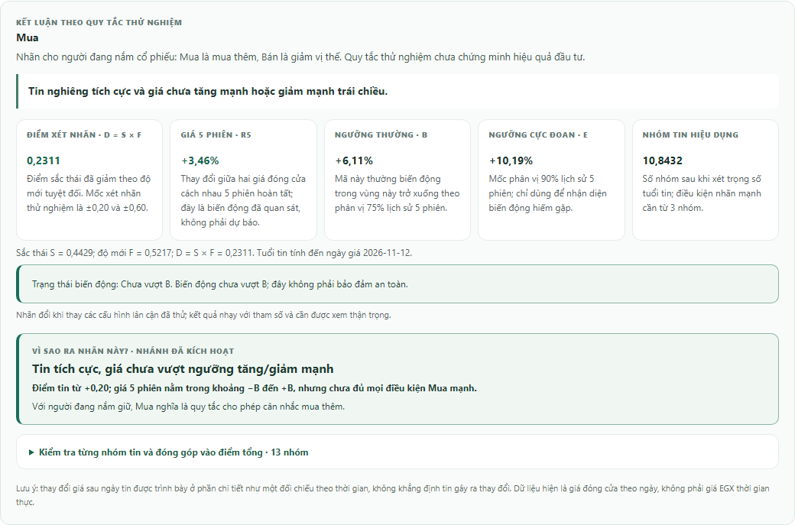
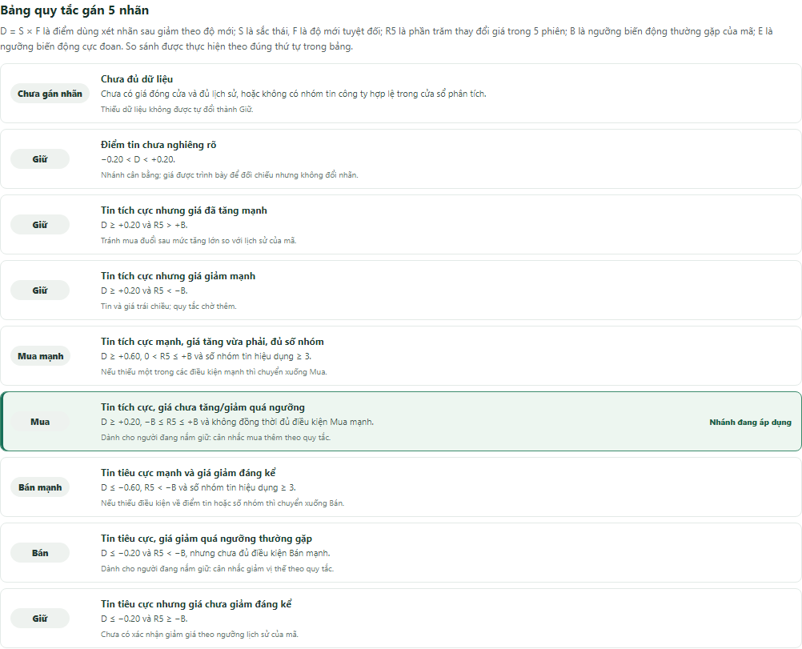
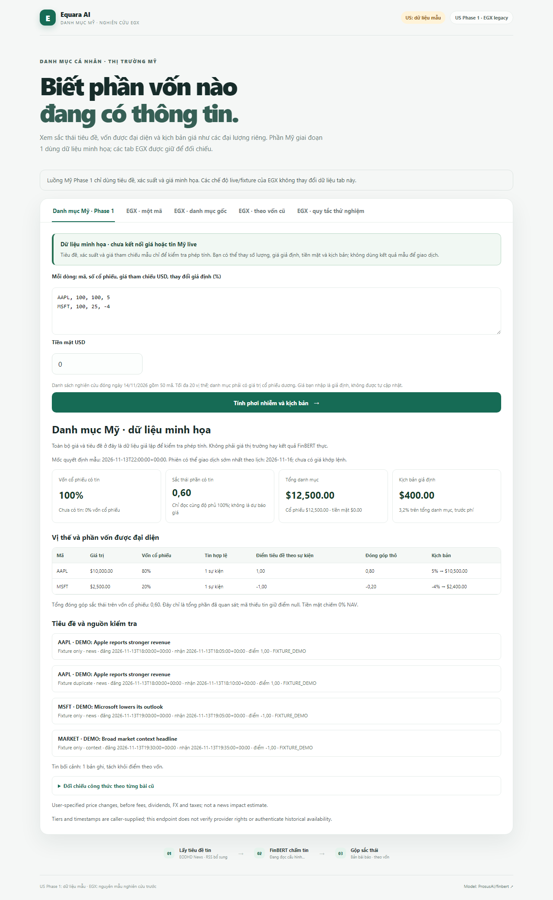

# Equara — FinBERT, tin–giá và danh mục đầu tư

**Dự án cá nhân về phân tích dữ liệu tài chính:** từ chấm sắc thái tin, theo dõi bằng chứng theo từng nhóm tin, đến thử nghiệm quy tắc gán nhãn theo tin và giá. Repository còn có một nhánh riêng cho danh mục cổ phiếu Mỹ (Phase 1).

> **Điểm cần xem đầu tiên:** luồng **Tin + Giá** cho EGX. Đây là phần biến điểm sắc thái và biến động giá thành một trong năm nhãn có giải thích; nhãn là quy tắc nghiên cứu thử nghiệm, không phải khuyến nghị đầu tư.

## 1. Tin + Giá: quy tắc gán nhãn quyết định



*Ảnh chụp một lượt chạy minh họa ngày 16/11/2026: FinBERT chấm tin, giá đóng cửa có dữ liệu đến 12/11/2026. Đây là dữ liệu ngày có độ trễ, không phải giá thời gian thực.*

### Hệ thống gán nhãn như thế nào?

1. Chọn tin trực tiếp có mã doanh nghiệp khớp, xác suất FinBERT và thời điểm xuất bản hợp lệ trong cửa sổ 30 ngày trước ngày giá.
2. Gom tiêu đề gần trùng thành nhóm tạm; một nhóm không được tính lặp như nhiều sự kiện độc lập.
3. Tính điểm nhóm từ `P(tích cực) − P(tiêu cực)`, giảm trọng số theo tuổi tin với half-life 7 ngày. Từ đó tính điểm tin đã điều chỉnh `D = S × F`.
4. Tính `R5` từ giá đóng cửa điều chỉnh hiện tại so với năm phiên trước. So sánh độ lớn với ngưỡng `B` (phân vị 75%) và `E` (phân vị 90%) của biến động năm phiên lịch sử của mã.
5. Áp dụng bảng quy tắc và hiển thị lý do, điều kiện, nhóm tin, mức nhạy với tham số.

| Nhãn | Ý nghĩa trong prototype |
| --- | --- |
| **Mua mạnh** | Điểm tin từ `+0,60`, giá tăng nhưng chưa vượt `B`, và số nhóm tin hiệu dụng đạt ít nhất 3. |
| **Mua** | Điểm tin từ `+0,20`; giá chưa tăng hoặc giảm quá `B`; chưa thỏa đồng thời các điều kiện Mua mạnh. Với người đang nắm giữ, nhãn này nghĩa là cân nhắc mua thêm theo quy tắc. |
| **Giữ** | Điểm tin trung tính, tin và giá trái chiều, hoặc tin tiêu cực chưa được giá xác nhận theo ngưỡng. |
| **Bán** | Điểm tin từ `−0,20` trở xuống và giá giảm quá `B`. Với người đang nắm giữ, nhãn này nghĩa là cân nhắc giảm vị thế theo quy tắc. |
| **Bán mạnh** | Điểm tin từ `−0,60` trở xuống, giá giảm quá `B`, và số nhóm tin hiệu dụng đạt ít nhất 3. |
| **Chưa gán nhãn** | Thiếu giá ngày/lịch sử, hoặc không có nhóm tin trực tiếp đủ điều kiện. Thiếu dữ liệu không tự biến thành nhãn Giữ. |

Các ngưỡng trên là **quy ước thử nghiệm ban đầu**, chưa được tối ưu hoặc kiểm định để chứng minh hiệu quả đầu tư. `B` và `E` mô tả biến động lịch sử; chúng không cho biết giá “đắt/rẻ”, không dự báo đảo chiều và không chứng minh tin gây ra biến động giá.



## 2. Nghiên cứu EGX: FinBERT và phản ứng giá quan sát

Nhánh nghiên cứu này tái dựng và mở rộng một demo phân tích tin tài chính cho cổ phiếu trên sàn Ai Cập (EGX). FinBERT là mô hình pretrained của ProsusAI được tích hợp vào ứng dụng; đây không phải mô hình do dự án tự huấn luyện.

- Lấy tiêu đề tin, xác định mã/doanh nghiệp, lưu thời điểm và nguồn để người xem kiểm tra lại.
- Tổng hợp xác suất tích cực/trung tính/tiêu cực theo tin và theo danh mục; hỗ trợ điều chỉnh trọng số theo tỷ trọng vốn ở luồng danh mục.
- Ở luồng Tin + Giá, đối chiếu từng nhóm tin với các cửa sổ giá 1, 3 và 5 phiên sau ngày đăng để mô tả **mối liên hệ quan sát được**. Các cửa sổ có thể chồng lấn và không xác định quan hệ nhân quả.
- Lọc tin không liên quan, thiếu thời điểm hoặc chưa đủ bằng chứng doanh nghiệp; phần bị loại được ghi lý do.

## 3. Danh mục Mỹ — Phase 1

Phase 1 tách riêng khỏi nghiên cứu EGX và bộ quy tắc gán nhãn. Người dùng có thể khai báo số lượng cổ phiếu, tiền mặt, giá tham chiếu và biến động giả định để xem độ phủ tin, phơi nhiễm theo vốn và đóng góp của từng mã. Mục đích là làm rõ cách danh mục tổng hợp tín hiệu khi tỷ trọng vốn khác nhau.



Fixture là dữ liệu minh họa do dự án tạo, không phải kết quả FinBERT hay dữ liệu thị trường trực tiếp. Nhánh sổ cái cục bộ có dữ liệu SEC/Alpaca hồi cứu và mức provenance riêng; bản ghi tải sau mốc quyết định được gắn nhãn replay ngoài PiT. Endpoint không thể tự chứng thực thời điểm phát hành thực tế, quyền dữ liệu hoặc chất lượng giá.

Các mốc sau Phase 1 (sổ cái, PiT/replay và quy trình tạo tác vụ gán nhãn đánh giá) là các nhánh nghiên cứu riêng, được ghi rõ tình trạng trong tài liệu; không nên đọc như kết quả đã được benchmark độc lập. Bắt đầu từ [trạng thái US Phase 1](docs/US_PHASE1_STATUS.md), [US Phase 2](docs/US_PHASE2_STATUS.md), [giao thức gán nhãn Phase 2.5](docs/US_PHASE25_ANNOTATION_PROTOCOL.md) và [giao thức replay Phase 3](docs/US_PHASE3_SIGNAL_PROTOCOL.md).

## Công nghệ và chạy thử

**Python · FastAPI · FinBERT/Transformers · JavaScript · yfinance · SEC/Alpaca adapters (tùy cấu hình)**

Cần Python 3.12. Tạo môi trường và cài dependency:

```powershell
py -3.12 -m venv .venv
.\.venv\Scripts\python.exe -m pip install -r requirements.txt
$env:DEMO_MODE='fixture'
.\.venv\Scripts\python.exe -m uvicorn backend.app:app --host 127.0.0.1 --port 8124
```

Mở `http://127.0.0.1:8124`. Chế độ `fixture` cho phép xem giao diện mà không cần khóa nhà cung cấp; Tin + Giá sẽ không gán nhãn từ việc ghép tin giả lập với giá thật. Để chạy FinBERT cục bộ trên dữ liệu tin, cấu hình `INFERENCE_PROVIDER=transformers-local` và cài dependency mô hình; lần chạy đầu cần tải model từ Hugging Face. Các nguồn tin, giá và khóa tùy chọn được mô tả trong [`.env.example`](.env.example).

## Dự án cá nhân và cách ghi nhận đóng góp

Đây là **dự án cá nhân**. Tôi xác định bài toán và phạm vi, đề ra yêu cầu cho luồng danh mục và Tin + Giá, rà kết quả demo, phản biện cách cân trọng số/hiển thị lý do và kiểm tra các giới hạn dữ liệu. Quá trình triển khai có sử dụng công cụ AI hỗ trợ đề xuất và sửa mã, tài liệu, kiểm thử; tôi không trình bày FinBERT pretrained hay toàn bộ mã nguồn như nghiên cứu/mã viết độc lập hoàn toàn. Chi tiết ở [`docs/PERSONAL_CONTRIBUTION.md`](docs/PERSONAL_CONTRIBUTION.md).

## Ranh giới nghiên cứu

- Nhãn là đầu ra của quy tắc giải thích được, **chưa backtest độc lập và chưa chứng minh lợi nhuận**.
- Giá lịch sử theo ngày có độ trễ; chưa đối soát độc lập mọi phiên giao dịch và corporate actions.
- Gom tiêu đề theo độ tương tự là nhóm tạm, có thể gộp nhầm hoặc bỏ sót tin trùng.
- Kết quả phản ứng giá là tương quan quan sát; không suy diễn tin là nguyên nhân.
- Đây là prototype phục vụ học tập và nghiên cứu; không phải tư vấn tài chính hay hệ thống giao dịch.

## Tham khảo và ghi công

Bài viết tham khảo về luồng demo EGX: Mohamed Hendawy, *Sentiment Analysis for Egyptian Stocks*. Mô hình FinBERT được kế thừa từ [ProsusAI/finBERT](https://github.com/ProsusAI/finBERT); dự án không sửa repository upstream. Nguồn và các thông báo bên thứ ba nằm trong [tài liệu ghi công](docs/THIRD_PARTY_NOTICES.md).
