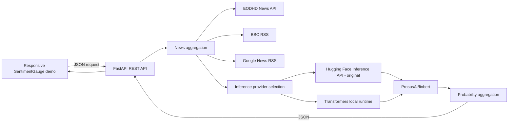

# Kiến trúc và quyết định tái dựng

## Phạm vi nguồn

Tài liệu được đối chiếu là bài viết kỹ thuật của Mohamed Hendawy về Equra AI/EGX, phát hành trên Medium. Đây không phải bài nghiên cứu học thuật FinBERT và không đi kèm mã nguồn ứng dụng. Repository upstream `ProsusAI/finBERT` là dự án riêng và không bị chỉnh sửa. Backend giữ adapter Hugging Face Inference API được bài viết mô tả, đồng thời có lựa chọn triển khai local Transformers dùng cùng model.

## Luồng tổng thể



## Đối chiếu bài báo với mã tái dựng

| Thành phần bài báo | Thực hiện trong ứng dụng | Trạng thái / khác biệt |
|---|---|---|
| `News Aggregation → NLP Inference → Aggregation & API` | Backend FastAPI gọi service tin, inference, rồi trả JSON; frontend gọi REST API | Có thể chạy cục bộ; là mã tái dựng, không phải source Equra AI |
| Micro/company news từ EODHD | `/api/news?s=<SYMBOL.EGX>`; EODHD được ưu tiên, khi thiếu token, lỗi hoặc danh sách rỗng thì dùng Google News RSS | Backend nhận token qua process environment; Colab đọc Secret bằng `google.colab.userdata`. COMI preflight và bốn request portfolio mới đều HTTP 200/0. Luồng fallback đã chạy, nhưng không có headline EODHD thực tế. |
| Macro/Egypt từ EODHD | Lấy general news feed EODHD rồi lọc tiêu đề/nội dung có `Egypt`, `Egyptian`, `Cairo` hoặc `EGX` | **Lựa chọn tái dựng**: bài báo chỉ ghi “EODHD Egypt”, không công bố endpoint/filter cụ thể |
| BBC RSS và Google News fallback | BBC Middle East RSS, lọc mục có từ khóa Egypt; nếu không có mục phù hợp thì Google News RSS query theo macro hoặc mã/công ty | BBC và Google News RSS endpoint được gọi kiểm tra thật, đều trả HTTP 200 trong lần triển khai; nội dung mỗi lần gọi thay đổi |
| Gộp và loại trùng | Khóa = URL đã chuẩn hóa (chữ thường ở scheme/host, bỏ query, fragment và dấu "/" cuối); chỉ khi không có URL mới dùng tiêu đề chuẩn hóa (chữ thường, bỏ dấu câu). Bản đến trước được giữ; bản không có khóa bị bỏ. Loại trùng chạy trước khi lọc tin cũ hơn 90 ngày, nên một bản quá hạn đến trước có thể che bản còn hạn cùng khóa | **Lựa chọn tái dựng**: bài báo không nêu quy tắc dedupe. Tab 1–2 giữ nguyên hành vi này (có kiểm thử khóa); tab 3 dùng luật loại trùng riêng relevance-v3, xem `docs/PHAN_C_DO_PHU_TIN_VI.md` mục 3 |
| Một mã: khoảng 10–15 tiêu đề | Gộp micro+macro, sắp xếp theo thời gian xuất bản nếu có, lấy tối đa 15; cảnh báo khi dưới 10 | Có thể thay đổi theo feed và token; không tự tạo headline khi thiếu tin |
| FinBERT `ProsusAI/finbert` qua HF API | HF Inference Provider `hf-inference`; `top_k=3`, `function_to_apply="softmax"`; yêu cầu đủ ba label | Giữ nguyên làm lựa chọn triển khai gốc; cần `HF_TOKEN` và credits/provider access |
| FinBERT `ProsusAI/finbert` local | Transformers/PyTorch tải đúng model revision vào backend, chạy CPU mặc định và áp softmax lên logits; có thể chọn CUDA nếu runtime hỗ trợ | Lựa chọn triển khai bổ sung; không gọi HF Inference API. Khác cách triển khai trong bài, không đổi model hoặc luồng nghiệp vụ |
| Batch inference khoảng 15 headline/request | **[Bản nâng cấp]** Gửi tối đa 15 tiêu đề trong một request (`inputs` là mảng); nếu HF trả 400/413/422 hoặc không trả mỗi đầu vào một danh sách 3 nhãn thì tự quay về gửi từng tiêu đề và nhớ lựa chọn đó | Khớp mục 8 bài báo. Có kiểm thử với HF giả lập; chưa kiểm chứng với HF thật vì tài khoản bị HTTP 402. Bản gốc gửi từng tiêu đề vì schema HF hiện hành ghi `inputs` là chuỗi |
| App gọi `GET sentiment` (sơ đồ mục 2–3) | **[Bản nâng cấp]** Thêm `GET /api/sentiment/stock?symbol=COMI` và `GET /api/sentiment/portfolio?symbols=COMI,ETEL,FWRY`, dùng chung schema và service với route POST | Cùng đầu vào cho cùng JSON (có kiểm thử); route POST cũ giữ nguyên |
| Bullish/Bearish/Neutral và REST JSON | Tính xác suất trung bình, ánh xạ nhãn, trả ba xác suất và score | **Lựa chọn tái dựng**: công thức tổng hợp không được công bố trong bài |
| Portfolio tối đa 5 mã | Request cho phép 1–5 mã EGX không trùng; lấy tối đa 2 micro/mã và 4 macro, tổng tối đa 14 tiêu đề | Đã kiểm tra với RSS thật và local FinBERT trên Backend; nguồn thưa có thể làm số headline thấp hơn tối đa |
| SentimentGauge mobile app | Trang HTML/CSS/JS responsive, chạy trên browser điện thoại hoặc desktop | Bản trình bày tương đương, không phải ảnh hay source giao diện gốc |

## Chi tiết nguồn tin

- **Micro:** EODHD nhận ticker dạng `COMI.EGX`, `ETEL.EGX`, `FWRY.EGX`. Tên query Google News được dựng từ mã/tên công ty.
- **Macro:** bài báo không chỉ ra filter EODHD cho Egypt. Code gọi feed general đã được tài liệu EODHD mô tả, sau đó lọc cụm `Egypt`, `Egyptian`, `Cairo`, `EGX`. Đây là heuristic tái dựng, không phải lựa chọn đã xác nhận của tác giả.
- **Fallback:** micro dùng Google News RSS nếu EODHD trả rỗng/lỗi; backend macro ưu tiên EODHD general news đã lọc Egypt rồi BBC Middle East RSS và Google News RSS. Colab dùng BBC RSS rồi Google News RSS cho macro để tránh request EODHD general feed ngoài lượt kiểm tra tối thiểu. `empty:0` nghĩa là provider không có headline; `skipped_*` nghĩa provider không được gọi vì nguồn ưu tiên đã có tin.
- **Dedupe:** ưu tiên URL sau khi bỏ query string và fragment; nếu URL thiếu thì dùng tiêu đề lowercase, xóa dấu câu và khoảng trắng dư.
- **Thứ tự:** ngày xuất bản ISO mới nhất lên trước; mục thiếu thời gian đi sau. Khi thiếu ngày, thứ tự gốc của feed được giữ ổn định.
- **Giới hạn:** không có ngày xuất bản cũ để bù, không ghép nội dung thân bài vào model; chỉ dùng headline, đúng phạm vi bài mô tả.
- **Xác thực ticker:** backend kiểm tra cú pháp và bắt buộc hậu tố `.EGX`, nhưng không tải danh sách thành viên EGX để xác nhận từng mã. Danh sách chọn nhanh chỉ có ba ví dụ bài báo; mã khác có thể được gửi đi và trả về rỗng nếu không tồn tại/không có tin.

## Inference và điểm batch

Backend chọn provider bằng `INFERENCE_PROVIDER`. Mặc định `transformers-local` nạp `ProsusAI/finbert` với revision `0bc2ac10dda6929bcb1f77ccc43c7ec5c424f031` trong tiến trình FastAPI. Device mặc định là CPU; `LOCAL_INFERENCE_DEVICE=auto` chọn CUDA khi PyTorch/runtime có CUDA. Lần đầu có thể tải model weights công khai từ Hugging Face Hub; đây là tải file model, không phải gọi Inference API.

`INFERENCE_PROVIDER=hf-inference` vẫn dùng adapter, endpoint, bearer token, `top_k=3` và `function_to_apply=softmax` như trước. Hai provider không tự động fallback sang nhau. Response local ghi provider, revision, device, số headline được model xử lý và `inference_http_requests=0` để phân biệt với API.

Local Transformers tính softmax từ cùng logits của model; batch nội bộ tối đa 16 tiêu đề chỉ là tối ưu thực thi trong process. Nó không thay đổi pipeline nghiệp vụ, model, nhãn, hoặc công thức tổng hợp; nó thay vị trí chạy inference so với kiến trúc serverless API của bài viết.

Adapter HF gốc vẫn gọi `https://router.huggingface.co/hf-inference/models/ProsusAI/finbert` bằng bearer token, payload cho mỗi tiêu đề:

```json
{
  "inputs": "headline text",
  "parameters": {
    "top_k": 3,
    "function_to_apply": "softmax"
  }
}
```

Hugging Face hiện mô tả `inputs` là chuỗi đơn và `InferenceClient.text_classification` nhận một `text: str`. Vì vậy bản gốc tuần tự hóa từng headline thành một request. **Bản nâng cấp** làm đúng mục 8 bài báo: gửi `inputs` là mảng tối đa 15 tiêu đề và chờ HF trả mỗi đầu vào một danh sách 3 nhãn. Nếu HF từ chối (400/413/422) hoặc trả sai dạng, adapter tự quay về cách gửi từng tiêu đề như trên và ghi `request_mode` tương ứng. Lỗi xác thực, hết quota hay model chưa sẵn sàng (401/402/403/429/503) vẫn báo lỗi như cũ, không bị che bởi cơ chế quay về. Đã kiểm thử với HF giả lập và HTTP qua máy chủ tự dựng. Router HF công cộng chưa xác nhận HTTP 200.

Bài báo không nêu revision/commit model trên Hugging Face. Adapter dùng model ID `ProsusAI/finbert` hiện hành, không khóa revision; vì vậy khi model/provider cập nhật trong tương lai, xác suất có thể khác.

## Công thức tổng hợp được tái dựng

Với headline `i`, model trả `pᵢ(positive)`, `pᵢ(negative)`, `pᵢ(neutral)`. Với `N` headline:

```text
P(label) = sum(pᵢ(label)) / N
score = P(positive) - P(negative)
```

- Bullish nếu `P(positive)` là cực đại duy nhất.
- Bearish nếu `P(negative)` là cực đại duy nhất.
- Neutral nếu `P(neutral)` là cực đại hoặc có hòa.

Mỗi headline có trọng số ngang nhau. Bài báo không cung cấp công thức/weights nên đây là lựa chọn minh bạch của lần tái dựng.

## Có source / không có source

- **Có source upstream:** FinBERT classifier/training utilities trong repository ProsusAI/finBERT; checkout gốc được giữ nguyên.
- **Không có source Equra AI:** news orchestration cụ thể, REST contract, portfolio aggregation, SentimentGauge/mobile screens, deduplication rules và công thức Bullish/Bearish/Neutral. Các phần đó trong thư mục này là mã tái dựng theo mô tả, không được coi là source gốc.
- **Đã có bằng chứng chạy thật:** Backend đã thu thập Google News RSS/BBC RSS và chạy model Transformers local. Colab đọc được Secret; người dùng đã cung cấp COMI HTTP 200/0, sau đó Portfolio gửi một request cho mỗi ETEL/FWRY/ADIB/EFIH và cả bốn cũng HTTP 200/0. EODHD-first/fallback đã được thực thi; tất cả headline phân tích đến từ RSS, không có EODHD headline. Secret value không được in trong notebook output.
- **Chưa có kết quả thành công từ HF API:** adapter gốc được giữ riêng; lần thử trước được báo trả HTTP 402. Bản kiểm thử local không retry API và không sử dụng Inference Providers credits.

## Đối chứng phần A ngày 03/11/2026

Tab một cổ phiếu và danh mục dùng bộ lọc tên trong tiêu đề hoặc mô tả, với truy vấn Google bậc 1. Tên đội bóng Telecom Egypt có thể làm lọt tiêu đề thể thao. Lượt 14:25 được ghi trong biên bản bàn giao có 3/0/0 tin riêng cho COMI/ETEL/FWRY. Bảng trong `docs/BANG_TAB1_03-11.md` ghi một lượt độc lập khác. Dưới 10 tiêu đề, web báo số thật. Kim quay (score + 1) × 90 độ từ hướng trái. Cả ánh xạ kim và phép trung bình là lựa chọn của nhóm tái dựng.
